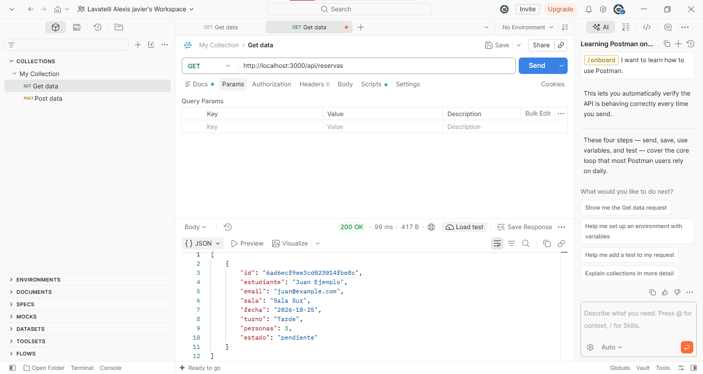
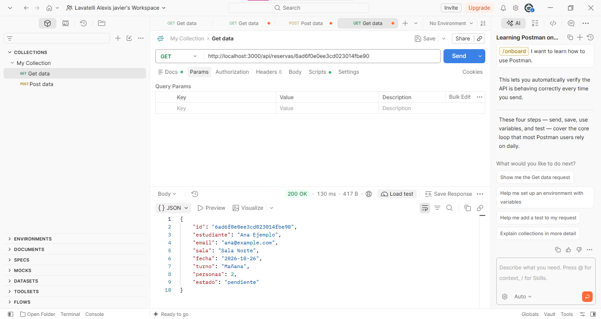
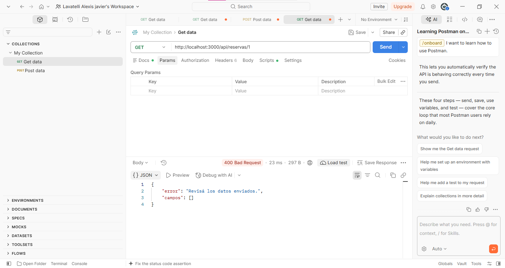
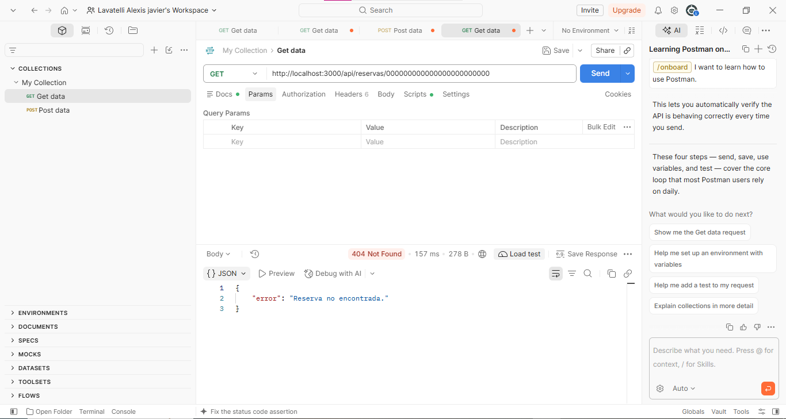
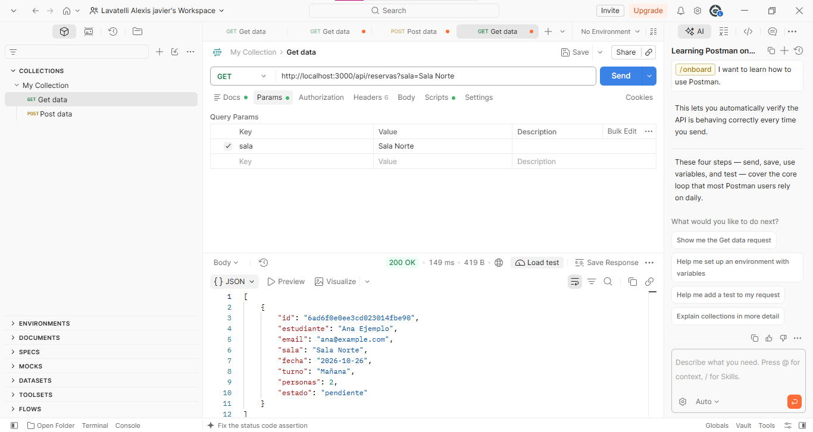
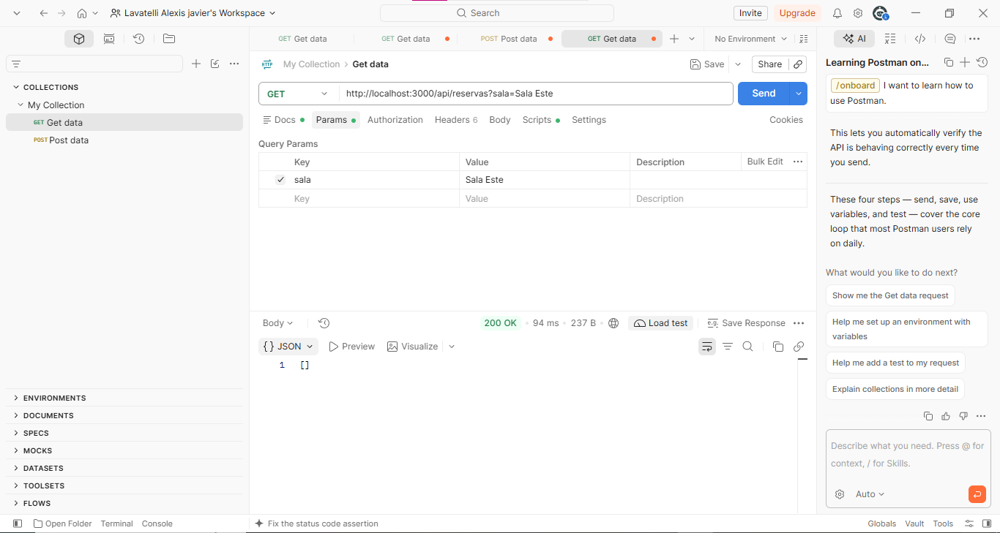
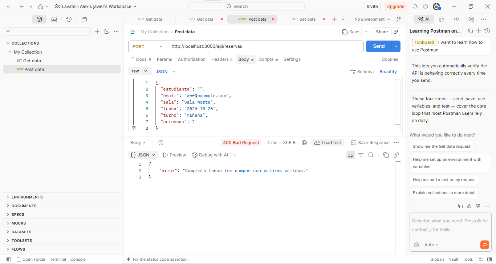

# TP 08 - Reservas de salas con Express y MongoDB

## De dónde viene este trabajo

Este proyecto es una copia del TP 07. En el TP 07 el sitio guardaba reservas en un arreglo y los scripts guardaban en Atlas. Ahora el sitio web y la API usan la misma base de datos. Se conserva el TP 07 separado.

## Tecnologías

- Node.js (usar una versión que soporte `--env-file`, por ejemplo Node 22)
- Express 5, EJS, Mongoose 8, MongoDB Atlas Free M0, CommonJS
- Prettier y ESLint para revisar el proyecto

## Cómo prepararlo

1. Crear o reutilizar un clúster gratuito M0 en Atlas.
2. Crear usuario de base de datos con lectura y escritura y permitir la IP de la computadora.
3. Copiar `.env.example` como `.env` y cambiar USUARIO, CLAVE y HOST por los datos privados de Atlas. Usar la base **reservas_salas_u8**. Mantener las opciones reales de la URI de Atlas. No compartir `.env`.
4. Abrir una terminal en esta carpeta y ejecutar `npm install` para instalar las dependencias. Se incluye `package-lock.json` de la copia entregada.
5. Probar `node --env-file=.env scripts/comprobar-conexion.js`.
6. Iniciar el servidor con `node --env-file=.env src/index.js` (o `npm run start:local`).
7. Abrir `http://localhost:3000` y `http://localhost:3000/reservas`.

El archivo `src/config/base-datos.js` tiene los DNS `8.8.8.8` y `1.1.1.1`, usados en la clase. Si la red no los permite, hay que consultar el ajuste autorizado. No soluciona credenciales ni IP no permitida.

## Carpetas principales

- `src/config`: lee variables de entorno y conecta MongoDB.
- `src/modelos/reserva.js`: reglas de las reservas.
- `src/servicios/reservas-mongo.js`: creación y consultas a MongoDB.
- `src/controladores/reservas.js`: respuestas HTML y JSON.
- `src/rutas/reservas.js`: páginas HTML.
- `src/rutas/reservas-api.js`: rutas de la API.
- `src/middleware`: validaciones, solicitudes y errores.
- `scripts`: programas para probar MongoDB desde la terminal.
- `views`, `public`: páginas y estilos existentes.
- `src/servicios/reservas.js`: referencia antigua en memoria; **ya no se importa en el arranque**.

## Modelo

La colección se llama `reservas`. Los campos son estudiante (texto obligatorio), email (texto con @), sala (Sala Norte, Sala Sur o Sala Multimedia), fecha (texto obligatorio), turno (Mañana, Tarde o Noche), personas (entero entre 1 y 6) y estado (pendiente por defecto, también admite confirmada). El cliente no puede elegir el estado al crear.

No se validan todavía fechas reales o futuras, cruces de horarios, cupos compartidos ni duplicados. El ID es un ObjectId de MongoDB mostrado como texto.

## API para probar en Postman

Servidor iniciado en `http://localhost:3000`. En GET usar Body **none**.

| Método | URL | Esperado |
| --- | --- | --- |
| GET | `/api/reservas` | 200 y lista, incluso `[]` |
| GET | `/api/reservas/:id` | 200 y reserva |
| POST | `/api/reservas` | 201, reserva y cabecera `Location` |
| GET | `/api/reservas?sala=Sala%20Norte` | 200, coincidencias exactas |
| GET | `/api/reservas/1` | 400 JSON |
| GET | `/api/reservas/000000000000000000000000` | 404 JSON si no existe |
| GET | `/api/reservas?sala=Sala%20Norte&sala=Sala%20Sur` | 400 JSON |

Para crear, en Postman seleccionar **POST**, `Body > raw > JSON`, con cabecera `Content-Type: application/json`:

```json
{
  "estudiante": "Ana Ejemplo",
  "email": "ana@example.com",
  "sala": "Sala Norte",
  "fecha": "2026-10-21",
  "turno": "Mañana",
  "personas": 2
}
```

Esperar 201. La respuesta debe tener `id`, los seis campos y `estado: "pendiente"`. En Headers de la **respuesta** copiar `Location`; hacer GET a esa URL para recuperar la reserva. Reiniciar el servidor y repetir el GET con el **mismo** ID sin volver a enviar POST.

## Pruebas adicionales

Hacer un POST por cada caso inválido, cambiando un dato a la vez: estudiante vacío, email sin @, sala y turno incorrectos, fecha vacía, personas 0, 7, 2.5, `"abc"`, `true`, `[]` u `{}`; también POST sin cuerpo y JSON mal formado. Debe responder 400 y la cantidad total debe mantenerse. Si se agregan `estado: "confirmada"` o `_id` junto con campos válidos, se deben ignorar esos campos y crear la reserva con estado pendiente e ID propio.

El formulario de `/reservas/nueva` debe redirigir (302) si es válido y responder 400 conservando valores si es inválido. `/estado` obtiene el total desde MongoDB. Inicio, CSS y página no encontrada continúan funcionando. Las rutas desconocidas de la API dan JSON.

Para revisar calidad:

```bash
npm run format
npm run check
```

## Resultados de las pruebas realizadas

Se probó la aplicación en Windows desde VS Code con MongoDB Atlas y Postman de escritorio. Los resultados indicados como **captura** tienen una imagen incluida en `capturas/`. Otros resultados fueron confirmados durante la realización del trabajo, pero no se adjuntó una captura específica. Las condiciones todavía no ensayadas quedan como **pendientes**.

| Prueba | Resultado observado | Evidencia |
| --- | --- | --- |
| Arranque con Atlas | Servidor disponible en puerto 3000 | Confirmado en terminal, sin captura incluida |
| GET `/api/reservas` | 200 y arreglo con reservas | `capturas/get-reservas.png` |
| POST válido | 201 y reserva creada | Confirmado en Postman, falta captura de 201 y `Location` |
| GET por ID creado | 200, se recupera Ana Ejemplo | `capturas/get-por-id.png` |
| GET después de reiniciar | Las reservas permanecieron | Confirmado, sin captura de comparación de IDs |
| GET ID `/1` | 400 JSON | `capturas/id-invalido-400.png` |
| GET ID válido inexistente | 404 JSON | `capturas/id-inexistente-404.png` |
| Filtro `Sala Norte` | 200, Ana Ejemplo | `capturas/filtro-sala.png` |
| Filtro `Sala Este` | 200, `[]` | `capturas/filtro-sin-coincidencias.png` |
| Parámetro `sala` repetido | 400 JSON | `capturas/filtro-repetido-400.png` |
| POST estudiante vacío | 400 JSON | `capturas/post-estudiante-vacio-400.png` |
| POST sin cuerpo | 400 JSON | Confirmado, sin captura |
| POST JSON incompleto | 400 JSON | Confirmado, sin captura |
| POST con `estado` e `_id` extra | 201; estado pendiente, ID nuevo | Confirmado, sin captura incluida |
| Consultar dos veces | Se informó cantidad estable de tres | Confirmado, sin capturas de ambas consultas |
| Formulario válido | Apareció en listado | Confirmado en navegador, sin captura |
| Formulario inválido | Mostró error y conservó valores | Confirmado en navegador, sin captura del estado HTTP |
| GET `/estado` | `servicio: activo`, `reservas: 3` | Resultado compartido durante las pruebas |
| `npm run check` | Prettier y ESLint terminaron sin errores | Salida de terminal confirmada, sin captura |
| Email, sala, turno, fecha y números inválidos | Pruebas no documentadas individualmente | Pendiente de registrar resultados |
| Personas tipo booleano, arreglo u objeto | No documentado | Pendiente |
| Ruta API desconocida y fallo de URI ausente | No documentado | Pendiente |
| Atlas Data Explorer (base U8) | No hay captura incluida | Pendiente |

### Capturas disponibles

**Listado GET**



**GET de una reserva por ID**



**ID inválido: 400**



**ID inexistente: 404**



**Filtro exacto: Sala Norte**



**Filtro sin coincidencias: lista vacía**



**Filtro repetido: 400**


**POST con estudiante vacío: 400**



### Lo que todavía falta documentar mejor

Para cumplir con toda la evidencia pedida por la consigna, conviene conservar capturas de: POST 201 mostrando la cabecera **Location**; GET del mismo ID antes y después del reinicio; cantidades antes/después de rechazos; prueba en Atlas Data Explorer; formulario válido con redirección y formulario inválido; y las variantes inválidas que aún no tengan resultado anotado. No ejecutar un POST válido otra vez solo para demostrar persistencia; eso crearía un documento nuevo.

**Cuidado:** Nunca subir el archivo `.env`, credenciales, URI privada ni la carpeta `node_modules`. El proyecto no incorpora resultados ficticios para sustituir pruebas no realizadas.

## Diferencia con el TP 07

Antes había dos fuentes de datos: memoria para la página y MongoDB para los scripts. Ahora la web y la API llaman al servicio MongoDB. No se importa la semilla ni el servicio de memoria en `src/index.js`. Los datos no se borran ni se insertan automáticamente al iniciar o listar. No se implementan PUT, PATCH o DELETE. Este servidor es educativo y no se debe publicar en Internet sin controles de seguridad adicionales.
